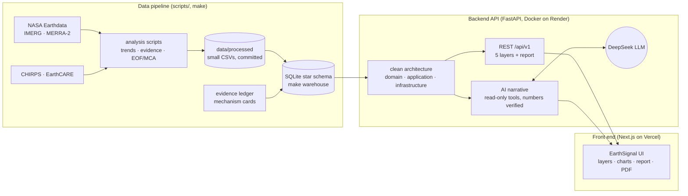

# EarthSignal: Earth System Trend Detective

**NASA Space Apps Challenge 2026 · *Earth Science Data Trend Detective***

EarthSignal turns NASA Earth observations into an investigation. Pick a Sahel region and a period: the app builds the
June–September rainfall series, tests whether the trend is real, finds what in the atmosphere and on the land moves
with the rain, weighs candidate physical mechanisms, explores scenarios to 2050 and compares adaptation options. Every
number comes from the analysis database, and every claim points to an entry in the evidence ledger.

| | |
|---|---|
| **Live app** | https://earthsignal-murex.vercel.app (no login needed) |
| **Live API** | https://earthsignal-api-cba64eb.onrender.com · interactive docs at [`/docs`](https://earthsignal-api-cba64eb.onrender.com/docs) |
| **30-second demo** | on the landing page ("See it in 30 seconds"), file `frontend/public/demo/earthsignal-demo.mp4` |

> The API runs on Render's free plan: after 15 minutes without visitors, the first request can take about a minute
> while it wakes up.

---

## The question and what we found

**Is Sahel rainfall changing, and why?** Season June–September (JJAS), 1998–2025, NASA GPM IMERG V07 rainfall,
checked against the independent CHIRPS v3 record.

| Finding | Numbers | Strength | Evidence |
|---|---|---|---|
| Sahel-wide rainfall: an upward **tendency, not a significant trend** | +3.1 %/decade, Mann–Kendall p = 0.161 (CHIRPS +3.4 %, p = 0.061) | depends on the start year | E-005 |
| The change is concentrated in the **eastern Sahel** (10–20°E) | rainfall +8.7 %/decade, p = 0.055 (CHIRPS +7.9 %, p = 0.026) | medium (sensitive to 2024) | E-007 |
| **Dry spells are getting shorter in the east** | longest dry spell −9.6 %/decade, p = 0.001 | medium-high: holds in every robustness test | E-007 |
| Wet seasons go with **more moisture, convergence and rising motion** | detrended ρ with water vapour 0.74, ascent 0.72, convergence 0.73 (all p < 0.001) | medium (reanalysis) | E-008, E-016, E-017 |
| The moistening is **not explained by local warming** | surface temperature flat or cooling; wetter years are cooler | low-medium | E-009 |
| Dust declined but **does not track rainfall** year to year | dust optical depth −0.03/decade (p < 0.001), ρ with rain −0.12 (p = 0.54) | low (assimilation changes) | E-010 |
| Best-supported mechanism: **West African Monsoon moisture supply (M-01)** | 7 of 8 expected observations consistent | medium (draft, under review) | `docs/research/evidence_cards.md` |

Associations are not causes, and scenarios are not forecasts. The full reasoning, alternative explanations and
limitations of each claim are in [`docs/research/evidence_ledger.md`](docs/research/evidence_ledger.md) (E-001 to E-018).

---

## How it works: five layers

| Layer | Question | What the app does |
|---|---|---|
| **1 · Detect** | Is there a trend? | Mann–Kendall test and Sen's slope with a 95 % interval, autocorrelation checks (pre-whitening, Hamed–Rao), linear regression cross-check, CHIRPS independent check, start-year sensitivity, extreme-rain indices (Rx1day, R95p, SDII, CDD). Charts show each test against α = 0.05. |
| **2 · Investigate** | What moves with the rain? | 12 MERRA-2 variables (moisture, circulation, dust, land surface) compared with rainfall after removing both trends (detrended Spearman ρ); EarthCARE radar and lidar storm cases (2024–2025) as process illustrations. |
| **3 · Explain** | Which mechanism fits? | Five candidate mechanisms, each with expected observations marked consistent / unclear / inconsistent and a draft confidence; expert confirmation is protected by a team key. |
| **4 · Project** | What if it continues? | Three conditional scenarios to 2050 (stabilisation, trend continuation, added stress), with a warning when the historical trend is not significant. |
| **5 · Solve** | What can be done? | Qualitative comparison of adaptation options (rainwater harvesting, mulching, agroforestry, soil and water conservation) with their unknowns. |

Then a **report** that leads with the key findings, an **AI narrative** ("Ask the data") whose numbers are checked
against the database, and a **PDF** built from the metrics.

### Data

| Dataset | Role | Agency |
|---|---|---|
| GPM IMERG V07 Final (monthly, daily) | trend dataset | NASA GES DISC |
| GPM IMERG V07 Late (daily) | near-real-time context, never used for trends | NASA GES DISC |
| MERRA-2 (single-level, integrated, aerosol, land, pressure levels) | atmosphere and land evidence | NASA GMAO |
| CHIRPS v3 | independent rainfall check | UCSB Climate Hazards Center |
| EarthCARE level 2 (CPR, ATLID, synergy) | storm-structure case studies | ESA–JAXA |

Details and access: [`docs/research/dataset_inventory.md`](docs/research/dataset_inventory.md),
[`docs/submission/nasa_data_used.md`](docs/submission/nasa_data_used.md).

---

## Architecture



- **Warehouse:** a SQLite star schema (observations, trends, relationships, mechanisms, evidence) rebuilt from the
  committed CSVs in about 10 seconds. See [`docs/app/data_model.md`](docs/app/data_model.md).
- **API:** FastAPI with clean architecture, SOLID, a Result pattern for errors and structured JSON logs.
  [`docs/app/backend_architecture.md`](docs/app/backend_architecture.md), contract in
  [`docs/app/api_contract.md`](docs/app/api_contract.md).
- **AI narrative:** the model never writes SQL. It may only call eight read-only tools (the investigation's results,
  the star-schema trend table, the evidence ledger…), and every number it writes is compared with the tool outputs;
  unmatched numbers are flagged on screen and in the PDF.
- **Front end:** Next.js 16 / React 19 / Tailwind 4, design by the team (EarthSignal), fed by the API through
  `frontend/src/lib/api.js` and `frontend/src/lib/liveLayers.js`. Investigations the analysis does not cover (other
  seasons, other main variables, custom regions) show a notice instead of mismatched numbers.

---

## Repository layout

```
frontend/                 Next.js app (EarthSignal UI): pages, charts (src/components/charts), report + PDF (src/components/report)
src/earth_detective/      Python library: data access, trend statistics (trend.py), catalogue
  backend/                API: core/ (settings, constants), domain/, application/ (use cases, narrative),
                          infrastructure/ (SQLite, LLM client, rate limiter), interfaces/http/ (FastAPI)
scripts/                  data fetch, analysis, warehouse build, smoke tests
sql/schema.sql            star schema
data/processed/           small derived CSVs (committed) · data/raw/ (downloads, git-ignored)
data/app/mechanisms.json  mechanism cards (Layer 3)
outputs/                  analysis tables and figures, EarthCARE cross-sections
tests/                    unit tests (in-memory fakes, fake LLM)
docs/                     challenge, decisions, research, app design, deployment, submission
Dockerfile · render.yaml  API image and Render blueprint
```

---

## Run it locally

Requirements: Python 3.12, Node.js 20+.

```bash
# 1. Python environment
uv venv .venv && uv pip install --python .venv/bin/python -r requirements.txt
#    (only the API: requirements-api.txt)

# 2. API on http://127.0.0.1:8000 (docs at /docs); builds the warehouse first if missing
make api

# 3. Front end on http://localhost:3000 (second terminal)
cd frontend && npm ci && npm run dev
```

Optional settings go in a git-ignored `.env` at the repository root (template: [`.env.example`](.env.example)):

| Variable | Purpose |
|---|---|
| `DEEPSEEK_API_KEY` | enables the AI narrative (leave empty to disable) |
| `TEAM_API_KEY` | protects expert confirmation (`POST /explain`) |
| `EARTHDATA_USERNAME` / `EARTHDATA_PASSWORD` | only to re-download NASA data (or use `~/.netrc`) |
| `ESA_MAAP_TOKEN` / `ESA_MAAP_CLIENT_SECRET` | only to re-download EarthCARE files |

The front end reads the API address from `NEXT_PUBLIC_API_URL` (default `http://127.0.0.1:8000`; template
`frontend/.env.example`). Never put a key in a `NEXT_PUBLIC_*` variable: those are public.

### Reproduce the science

```bash
make fetch       # download inputs: IMERG (NASA Earthdata login), CHIRPS, MERRA-2, EarthCARE (ESA MAAP token)
make analysis    # rerun every analysis on local data
make cards       # render the evidence cards
make warehouse   # rebuild the star schema from data/processed (no download needed)
```

The committed CSVs let anyone rebuild the warehouse and run the app without any account.

### Tests

```bash
make test                # 37 unit tests: domain rules, use cases, protections, narrative pipeline (fake LLM)
make smoke               # 47 live end-to-end checks against a running API (values checked against the ledger)
make smoke-protections   # rate limits, body-size limit, storage cap, team key (starts its own server)
```

---

## Deployment

Front end on **Vercel** (project root `frontend/`), API as a **Docker** image on **Render**
(image `docker.io/hacen123123/earthsignal-api`, or the `render.yaml` blueprint). Environment variables, CORS, checks
and the pre-launch checklist: [`docs/deployment.md`](docs/deployment.md).

## Safeguards

- **Scientific honesty:** significance at α = 0.05 with several tests, an independent dataset, start-year
  sensitivity and robustness checks; "tendency" instead of "trend" when not significant; associations never presented
  as causes; scenarios labelled as what-ifs.
- **Public API protections:** rate limits per client (general, heavy analyses, AI), request size limit, storage cap with
  automatic expiry, team key for expert actions, security headers, CORS limited to the app.
- **AI narrative:** read-only tools, numbers verified against the data, refusal of instructions hidden in questions,
  AI label on screen and in the PDF, hourly and daily caps.

## Documentation

| Topic | File |
|---|---|
| Challenge brief, rules, judging | [`docs/challenge/CHALLENGE_SUMMARY.md`](docs/challenge/CHALLENGE_SUMMARY.md) |
| Decisions (read first) | [`docs/decisions/DECISIONS.md`](docs/decisions/DECISIONS.md) (D-001 to D-014) |
| Framework and methods | [`docs/research/project_framework.md`](docs/research/project_framework.md), [`methods_pipeline.md`](docs/research/methods_pipeline.md) |
| Evidence and literature | [`evidence_ledger.md`](docs/research/evidence_ledger.md), [`evidence_cards.md`](docs/research/evidence_cards.md), [`how_to_read_evidence_cards.md`](docs/research/how_to_read_evidence_cards.md), [`literature.md`](docs/research/literature.md) |
| App design | [`docs/app/`](docs/app/) (API contract, data model, backend architecture) |
| Submission material | [`docs/submission/`](docs/submission/) (slides, demo-video script, AI-use log) |

## Team

- **Hacenbens**: team lead, science pipeline, data, backend
- **mehdibidjed**: front end (EarthSignal UI)
- **B-Manara**, **rania-zebiri**: team members; research contributions in `docs/team/contribution/`

### Working rules
- Read `docs/decisions/DECISIONS.md` first; change scope only through a new decision entry.
- Every claim in the app or slides needs a row in the evidence ledger; cite only papers marked `READ` in `literature.md`.
- Work on a branch (`<name>/<topic>`) and open a pull request into `main`.
- Raw data is not committed; small derived CSVs in `data/processed/` are.

## Use of AI

Following the Space Apps rules, every use of AI is logged in
[`docs/submission/si_usage.md`](docs/submission/si_usage.md): Claude Code (Anthropic) assisted with code, analysis
scripts, documentation and the demo video; DeepSeek generates the in-app narratives at run time; ElevenLabs voiced the
demo video. AI-generated media carry a visible watermark, and AI text in the app is labelled.
