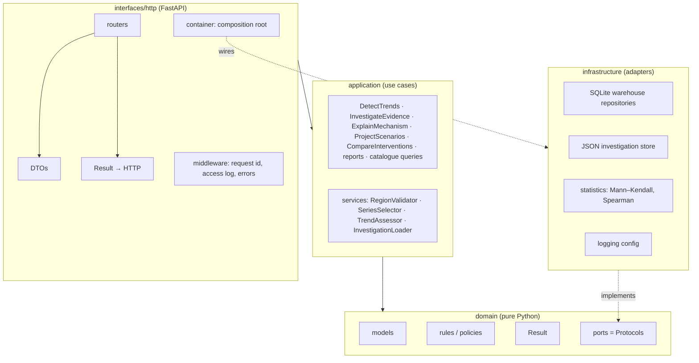

# Backend architecture

Clean architecture + SOLID + Result pattern + structured logging. Code: `src/earth_detective/backend/`. Run `make api`, test `make test`.
Drafted with AI assistance (Claude Code). See `docs/submission/si_usage.md`.

## 1. Layers and the dependency rule



| Layer | Knows about | Never imports |
|---|---|---|
| `core/` (shared kernel) | the standard library only | any other backend package, any framework |
| `domain/` | `core` + the standard library | FastAPI, pydantic, SQLite, application, infrastructure |
| `application/` | `core`, `domain` | FastAPI, pydantic, SQLite, infrastructure |
| `infrastructure/` | `core`, `domain` (+ scipy/sqlite) | application, interfaces |
| `interfaces/http/` | everything (it is the outermost ring) | — |

Checked with a grep on every change (`docs/app/backend_architecture.md` §6).

### The shared kernel: `core/`
Everything that several layers need and that is not business logic lives in `src/earth_detective/backend/core/`:

| Module | Content |
|---|---|
| `settings.py` | `Settings`, one immutable object read once from the environment (`get_settings()`); the **only** place that reads `os.environ` |
| `constants.py` | fixed method and API values: `ALPHA`, `MIN_SEASONS`, `FIRST_YEAR`/`LAST_YEAR`, `SEASON_MONTHS`, `SENSITIVITY_SPAN`, `EXTREME_METRICS`, `API_PREFIX`, `REQUEST_ID_HEADER`, log-file limits, shared disclaimers |
| `enums.py` | `ErrorKind`, `DatasetRole`, `DatasetKind`, `QualityFlag`, `Grain`, `TrendDirection`, `EvidenceCategory`, `EvidenceStatus`, `ExpectationStatus`, `Confidence`, `ScenarioKind`, `RainfallMetric`, `Layer`, `LogFormat` (all `StrEnum`: they serialise as plain strings) |
| `helpers.py` | pure functions: `utc_now_iso`, `new_investigation_id`, `is_valid_investigation_id`, `new_request_id`, `json_safe`, `linear_detrend`, `mean`, `rms` |

Settings (environment variables):

| Variable | Default | Meaning |
|---|---|---|
| `TREND_DETECTIVE_DB` | `data/warehouse/trend_detective.sqlite` | warehouse built by `make warehouse` |
| `TREND_DETECTIVE_STORE` | `data/app/investigations` | investigation JSON documents |
| `LOG_LEVEL` | `INFO` | DEBUG, INFO, WARNING, ERROR |
| `LOG_FORMAT` | `json` | json or text |
| `LOG_FILE` | none | optional rotating log file |
| `CORS_ORIGINS` | `*` | comma-separated allowed origins (set the front-end URL in production) |

Invalid values fail at start-up with a clear message. Constants are not settings: changing one changes the science or the API contract, so it goes through the decision log.

## 2. SOLID, concretely
| Principle | Where |
|---|---|
| **S**ingle responsibility | One use case per action (`DetectTrends`, `ExplainMechanism`, …). Services split by job: `RegionValidator`, `SeriesSelector`, `TrendAssessor`. Repositories split by concern (catalogue, observations, mechanisms, cases, build info). `SqliteWarehouse` only owns the connection. |
| **O**pen/closed | Dataset choice is a `DatasetRankingPolicy` (default `RoleThenCoveragePolicy`): a new policy is a new class. The evidence status rule, scenario formulas and expected signs live in `domain/rules.py`. A new layer = a new use case + router, nothing else edited. New interventions are data in `StaticInterventionCatalogue`. |
| **L**iskov substitution | Every adapter can replace another: the tests run all use cases on in-memory fakes (`tests/fakes.py`) with no SQLite and no FastAPI. |
| **I**nterface segregation | Small ports in `domain/ports.py`: `CatalogueReader`, `ObservationReader`, `MechanismReader`, `CaseStudyReader`, `InvestigationRepository`, `TrendAnalyzer`, `AssociationAnalyzer`, `Clock`, … Each use case receives only the ports it uses. |
| **D**ependency inversion | Use cases depend on `Protocol` ports; `interfaces/http/container.py` is the only place that names concrete classes. Moving to PostgreSQL means writing new repositories and changing the container. |

## 3. Result pattern
`domain/result.py`: `Ok(value)` / `Err(AppError(kind, message, details))`, with `map`, `and_then`, `unwrap_or`, `collect`, `partition`.
- Use cases **return** expected failures instead of raising them (unknown region, too few seasons, missing reviewer, numeric water balance without sources, CSV before detect).
- Batch steps keep partial results: `/detect` returns the trends it could compute and lists the rest in `skipped` with the error kind.
- `interfaces/http/responses.py` is the **single** place mapping errors to HTTP:

| ErrorKind | HTTP | Example |
|---|---|---|
| `not_found` | 404 | unknown investigation |
| `validation` | 422 | unknown region, period < 15 seasons, missing reviewer, malformed body |
| `conflict` | 409 | CSV report before `/detect` |
| `not_available` | 422 | numeric water balance without published parameters |
| `unexpected` | 500 | any unhandled exception (logged with traceback) |

Every error body has the same shape: `{"error": {"kind", "message", "details", "request_id"}}`.

## 4. Logging
`infrastructure/logging_config.py`, configured at app start.
- **JSON lines** by default (`LOG_FORMAT=json`), readable lines with `LOG_FORMAT=text`; level with `LOG_LEVEL`; optional rotating file with `LOG_FILE`.
- **Request ID** on every record: taken from the `X-Request-ID` header or generated, stored in a context variable, returned in the response header and in error bodies.
- **Access log** (`earth_detective.backend.access`): method, path, query, status, duration in ms (replaces uvicorn's access log).
- **Domain events** from use cases: `investigation.created`, `layer.detect`, `layer.investigate`, `layer.explain`, `layer.project`, `layer.solve`, with the investigation ID.
- **Errors**: every `Err` returned to a client is logged (`request.error`, level INFO for 4xx, ERROR for 5xx); unhandled exceptions are logged with the full traceback (`http.unhandled`).

Example (`LOG_FORMAT=text`):
```
02:20:40 INFO    [4ea0ad6942ea] earth_detective.backend.application.layers: detect completed | event=layer.detect investigation_id=02b05f5c2ec4 results=9 skipped=0
02:20:40 INFO    [89ca8fa736fa] earth_detective.backend.interfaces.http.responses: request failed | event=request.error kind=validation status=422 ...
02:20:40 INFO    [demo-123] earth_detective.backend.access: request | event=http.access method=GET path=/api/v1/regions status=200 duration_ms=0.8
```

## 4b. Protections (public demo)
The judges need a public link without login, so the API stays open for reading and running analyses, with limits against abuse. All limits are settings (environment variables, `core/settings.py`); errors use the usual `{error: {kind, message, details, request_id}}` body.

| Protection | Where | Setting (default) | Refusal |
|---|---|---|---|
| Rate limit, all endpoints, per client IP | `infrastructure/rate_limiter.py` + `ProtectionMiddleware` | `RATE_LIMIT_PER_MINUTE` (120) | 429 `rate_limited`, `Retry-After` header |
| Rate limit, heavy endpoints (create, detect, investigate, project) | same | `RATE_LIMIT_HEAVY_PER_MINUTE` (20) | 429 `rate_limited`, `details.scope = "heavy"` |
| Request body size | `ProtectionMiddleware` | `MAX_BODY_BYTES` (32768); chunked bodies without `Content-Length` refused | 413 `payload_too_large` |
| Storage cap | `CreateInvestigation` (business rule, `InvestigationHousekeeping` port) | `MAX_INVESTIGATIONS` (500) | 503 `capacity` |
| Expiry | `CreateInvestigation` deletes investigations idle longer than the TTL before checking the cap | `INVESTIGATION_TTL_DAYS` (7) | — |
| Team key on `POST /explain` (expert confirmation) | `require_team_key` dependency, constant-time compare | `TEAM_API_KEY` (unset = open, warning logged at start) | 401 `unauthorized` |
| Security headers on every response | `RequestContextMiddleware` | `nosniff`, `X-Frame-Options: DENY`, `Referrer-Policy: no-referrer`, `Cache-Control: no-store` | — |
| Client IP behind a proxy | `client_ip()` | `TRUST_PROXY_HEADERS` (false): only enable behind your own reverse proxy, the header is easy to forge | — |

Settings are read from the process environment, then from the git-ignored `.env` at the project root for names the environment does not set (`core/settings.py: read_env_file`, a plain KEY=VALUE reader that runs nothing). So `TEAM_API_KEY` in `.env` is enough for `make api`; `TREND_DETECTIVE_ENV_FILE=` (empty) skips the file.

Middleware order (outermost first): CORS → request context (request id, access log, security headers) → protection → routes, so refused requests are still logged with a request id and carry CORS headers. Start-up logs the settings without secrets (`Settings.describe()` reports only `team_api_key_set`).

Limits of this design: the rate limiter lives in one process's memory (several workers or servers need a shared store such as Redis); per-IP limits can be bypassed by an attacker with many addresses, so put the public deployment behind a platform with its own DDoS protection.

## 5. Request flow (detect)
`POST /api/v1/investigations/{id}/detect` → router → `DetectDTO.to_command()` → `DetectTrends.execute(cmd)` → `InvestigationLoader` (Result) → `RegionValidator` (Result) → `TrendAssessor` per region × metric (`SeriesSelector` + `TrendAnalyzer` port) → save through `InvestigationRepository` → `Ok(result)` → `to_response()` → JSON.

## 6. Tests and checks
- `make smoke` (with `make api` running): **47 live end-to-end checks** (`scripts/smoke_test_api.py`, standard library only): every endpoint, the scientific values against the evidence ledger (E-005, E-006, E-007, E-008, E-010), every error kind and its HTTP code, request-id generation/echo, CORS preflight, 24 concurrent requests. Last run 2026-11-15: 47/47 passed; JSON log file: 80 valid lines, request traced from use-case event to access line.
- Start-up failures are explicit: missing warehouse -> "Warehouse not found at … Build it with `make warehouse`"; invalid `LOG_FORMAT` -> ValueError listing the allowed values.
- Performance: `/detect` for 4 regions x (2 metrics + extremes) = 13 results takes ~1.4 s (was 4.5 s): sensitivity tables and independent checks use the Mann–Kendall/Sen-only mode (`TrendAnalyzer.analyze(full=False)`, identical MK/Sen values); the OLS/AR(1) cross-checks run once per main result.
- `make test`: 24 unit tests (domain rules, Result, every use case, rate limiter, storage cap and expiry, JSON store housekeeping, settings validation) on in-memory adapters.
- `make smoke-protections`: starts its own server with low limits and a throwaway team key; **10 live checks** (security headers, 413, 503 capacity, 401 without/with wrong key, key accepted, heavy 429 with `Retry-After` while light endpoints still answer, general 429). Last run 2026-11-15: 10/10 passed. `make smoke` still passes 47/47 with the default limits (export `SMOKE_API_KEY` when the server has `TEAM_API_KEY`).
- End-to-end check (2026-11-15): every endpoint returned the same numbers as the previous implementation (e.g. Sahel +3.1 %/decade p = 0.161; east CHIRPS +7.9 % p = 0.026; east dry spell −9.6 % p = 0.001).
- Dependency rule (also: `core/` imports no other backend package and no framework; `os.environ` appears only in `core/settings.py`): `grep -rnE "from \.\.(application|infrastructure|interfaces)|import (fastapi|sqlite3|pydantic)" src/earth_detective/backend/domain` returns nothing (same for `application/` against infrastructure and frameworks).
- Not yet: HTTP-level tests (need `httpx` for FastAPI's TestClient).
