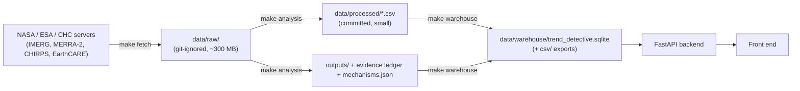
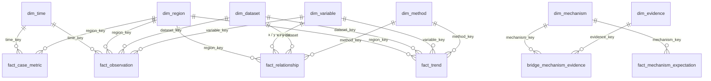

# Data model: the analytical warehouse (star schema)

The backend does not read scattered CSVs or NetCDF files. It reads one SQLite file, `data/warehouse/trend_detective.sqlite`, built by a single reproducible script from the processed data committed in the repo.
Drafted with AI assistance (Claude Code). See `docs/submission/si_usage.md`. Schema: `sql/schema.sql`. Build: `scripts/build_warehouse.py`. Metadata: `src/earth_detective/catalogue.py`.

## 1. Pipeline



- **Anyone can rebuild the warehouse in ~10 s** with `make warehouse`, because it needs only committed files (processed CSVs, the evidence ledger, `mechanisms.json`, EarthCARE case metrics). No login, no download.
- The warehouse itself is git-ignored: it is a build artefact, rebuilt at deploy time.
- **Trends and correlations are recomputed during the build** from `fact_observation`, with the same code as the analysis (`src/earth_detective/trend.py`). A changed input changes the facts, never by hand.
- Each build writes a row in `meta_build`: time, git commit, SHA-256 of every input file and row counts.

## 2. Star schema



### Dimensions
| Table | Rows | Grain / key | Content |
|---|---|---|---|
| `dim_time` | 377 | `time_key` = YYYYMM (month) or YYYY00 (JJAS season) | year, month, season, `satellite_era` (TRMM < 2014 ≤ GPM) |
| `dim_region` | 4 | sahel, west, central, east | bounding box, status (provisional, D-003b), GeoJSON polygon for maps |
| `dim_dataset` | 7 | IMERG Final monthly/daily, IMERG Late, CHIRPS v3, MERRA-2 (2), EarthCARE | product, version, agency, kind, **role** (trend / check / supporting / near-real-time / case-study), coverage, access, DOI, `is_nasa` |
| `dim_variable` | 29 | e.g. rain_total, CDD, TQV, shear_925_600 | label, unit, category, how a season is aggregated (sum / mean / index) |
| `dim_method` | 5 | e.g. mann_kendall_sen, spearman_detrended | description + reference |
| `dim_evidence` | 18 | E-001 … | claim and status, parsed from `docs/research/evidence_ledger.md` |
| `dim_mechanism` | 5 | M-01 … M-05 | name, description, confidence, interpretation (DRAFT) from `data/app/mechanisms.json` |

### Facts
| Table | Rows | Grain | Used by |
|---|---|---|---|
| `fact_observation` | ~25,000 | one value per time × region × dataset × variable (month or season) | Layer 1 and 2 time series |
| `fact_trend` | ~93 | one trend per region × dataset × variable × period (seasons 1998–2025) | Layer 1 trend panel, regional comparison |
| `fact_relationship` | ~216 | one detrended correlation per region × rainfall series × driver | Layer 2 evidence table |
| `fact_case_metric` | ~61 | one metric per EarthCARE case | Layer 2 vertical-structure panel |
| `fact_mechanism_expectation` | 28 | one expected observation per mechanism, with its status | Layer 3 mechanism cards |
| `bridge_mechanism_evidence` | 48 | mechanism ↔ evidence (supporting / contradicting / cited) | Layer 3 evidence links |

### Rules built into the data
- `quality_flag` = `ok`, `partial` (incomplete period, e.g. November 2026 Late Run) or `suspect` with a `note`: the extreme-intensity indices affected by the 2014 satellite change (E-006), and MERRA-2 aerosol values in 2025 (E-010).
- **Trends are only computed for datasets whose role allows it** (`trend`, `check`, `supporting`). The IMERG Late Run (`near-real-time`) and EarthCARE (`case-study`) never get a trend row.
- `direction` follows the significance rule: `increasing` / `decreasing` only when Mann–Kendall p < 0.05, otherwise `no_significant_trend`. `direction_hint` keeps the sign for "tendency" wording.
- A season value exists only when all four June–September months are present.

## 3. Views the API should read
| View | Returns |
|---|---|
| `v_observation` | readable time series (codes instead of keys) |
| `v_trend` | readable trend table |
| `v_relationship` | readable correlation table |

Example queries:
```sql
-- Layer 1: regional comparison of the season-total trend
SELECT region, dataset, round(pct_per_decade,1) AS pct_dec, round(mk_p,3) AS p, direction
FROM v_trend WHERE variable = 'rain_total' ORDER BY region, dataset;

-- Layer 1: time series for the chart
SELECT year, value FROM v_observation
WHERE grain = 'season' AND region = 'east' AND dataset = 'chirps_v3_monthly' AND variable = 'rain_total' ORDER BY year;

-- Layer 2: what moves with eastern rainfall?
SELECT x_variable, round(rho,2) AS rho, round(p_value,3) AS p FROM v_relationship
WHERE region = 'east' AND y_variable = 'rain_total' ORDER BY abs(rho) DESC;

-- Layer 3: a mechanism card
SELECT m.name, e.expectation, e.observed, e.status
FROM fact_mechanism_expectation e JOIN dim_mechanism m USING (mechanism_key) WHERE m.mechanism_id = 'M-01';
```

## 4. Checked on build (2026-11-15)
The rebuilt facts reproduce the published evidence: Sahel rain trend +1.37 mm/yr (p = 0.161, E-005); east CHIRPS +7.9 %/decade (p = 0.026) and IMERG +8.7 % (p = 0.055, E-007); east dry spell −9.6 %/decade (p = 0.001); water vapour +4.1 %/decade (E-008); ρ(water vapour, rain) = 0.74, ρ(dust, rain) = −0.12; 2026 season CHIRPS 381.9 mm and Late Run 335.7 mm (E-004). Foreign keys are checked at the end of every build.

## 5. Limits and next steps
- Gridded fields (maps) are not in the warehouse: they stay in NetCDF and will be served as pre-rendered JSON grids or images by the API.
- A region drawn by the user outside the four presets needs a live NASA fetch (see `docs/app/api_contract.md`): its results can be appended to `fact_observation` with the same keys.
- If the app later needs concurrent writes or larger data, the same schema moves to PostgreSQL unchanged (types are standard SQL).
